

 

<picture>
  <source media="(prefers-color-scheme: dark)" srcset="https://raw.githubusercontent.com/SayGuapix/SayGuapix/output/github-contribution-grid-snake-dark.svg" />
  <source media="(prefers-color-scheme: light)" srcset="https://raw.githubusercontent.com/SayGuapix/SayGuapix/output/github-contribution-grid-snake.svg" />
  
</picture>

 

## Tech Stack

 

## GitHub stats

 

<picture>
  <source media="(prefers-color-scheme: dark)" srcset="https://raw.githubusercontent.com/SayGuapix/SayGuapix/output/activity-bars-dark.svg" />
  <source media="(prefers-color-scheme: light)" srcset="https://raw.githubusercontent.com/SayGuapix/SayGuapix/output/activity-bars.svg" />
  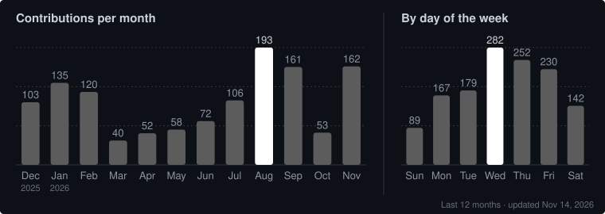
</picture>

 

## Featured Projects

Full portfolio at <a href="https://santiago.vercel.app/projects">santiago.vercel.app/projects</a>

<table width="100%">
<colgroup>
<col style="width:25%">
<col style="width:25%">
<col style="width:25%">
<col style="width:25%">
</colgroup>
<tr>
<td colspan="2"><a href="https://santiago.vercel.app/projects">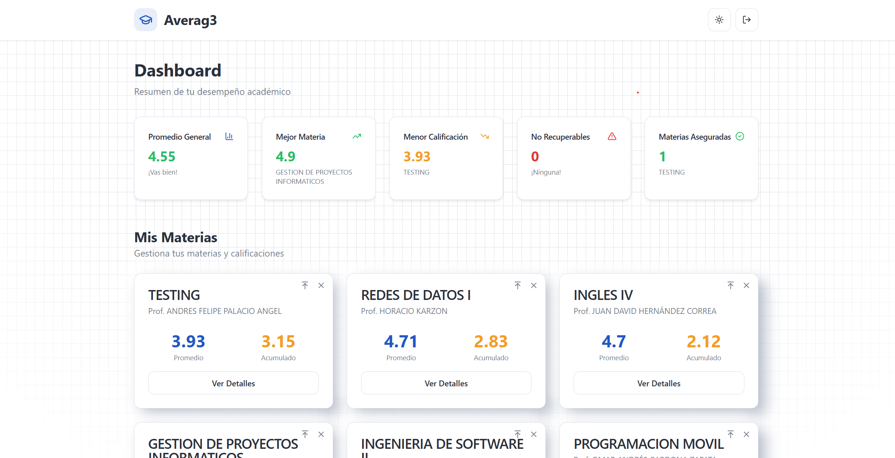</a></td>
<td><a href="https://santiago.vercel.app/projects">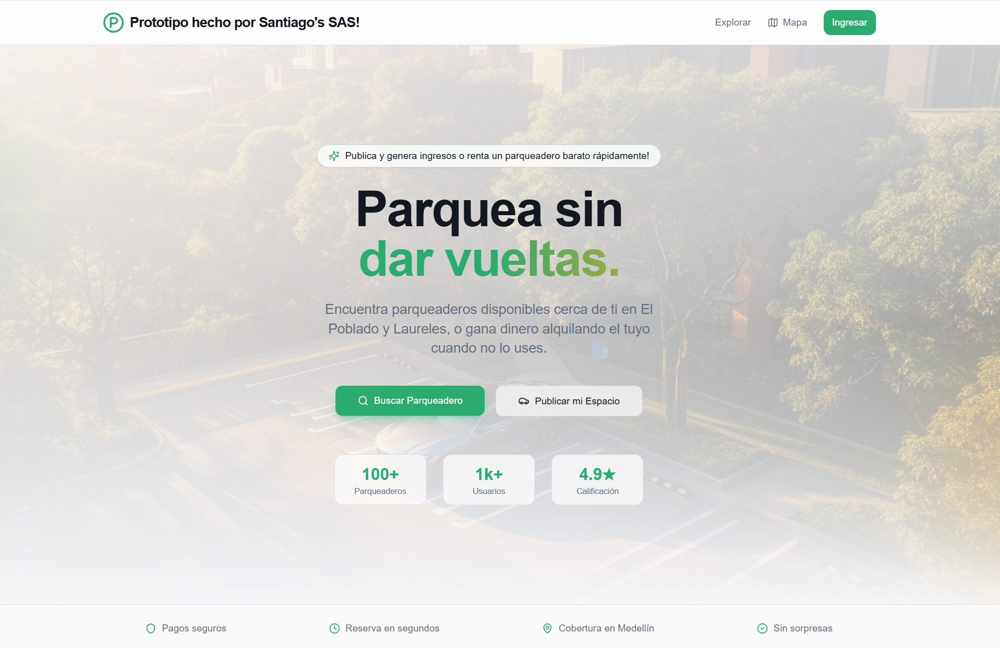</a></td>
<td><a href="https://santiago.vercel.app/projects">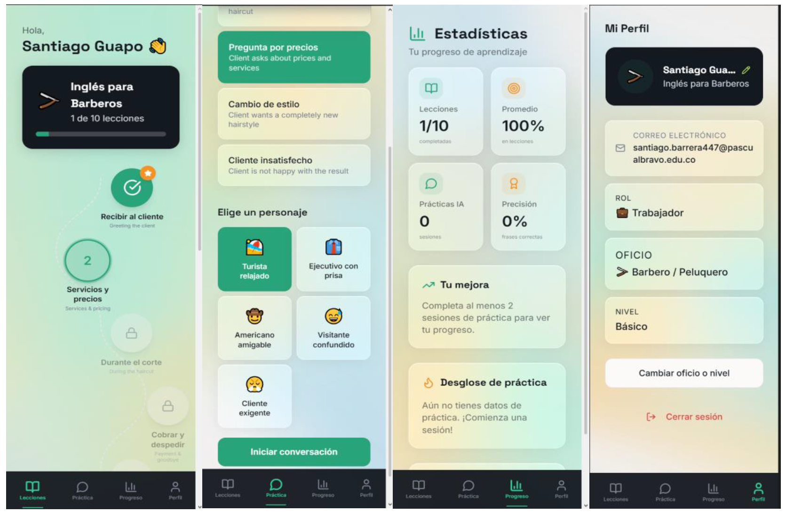</a></td>
</tr>
<tr>
<td><a href="https://santiago.vercel.app/projects">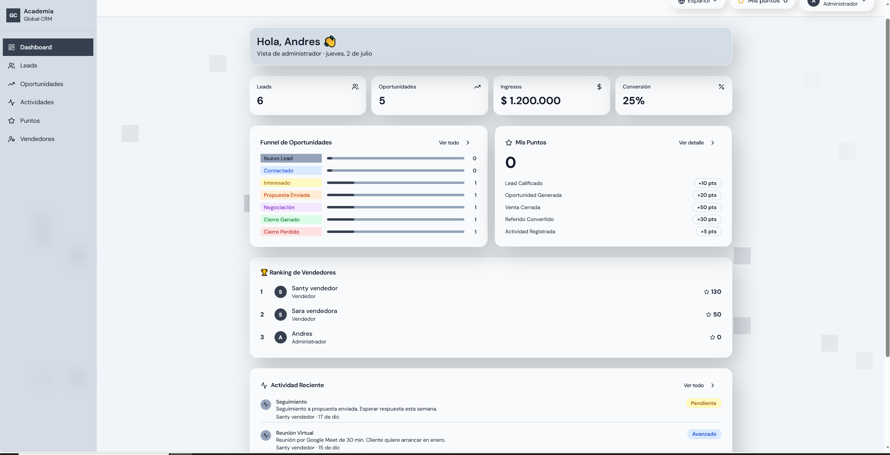</a></td>
<td colspan="2"><a href="https://santiago.vercel.app/projects">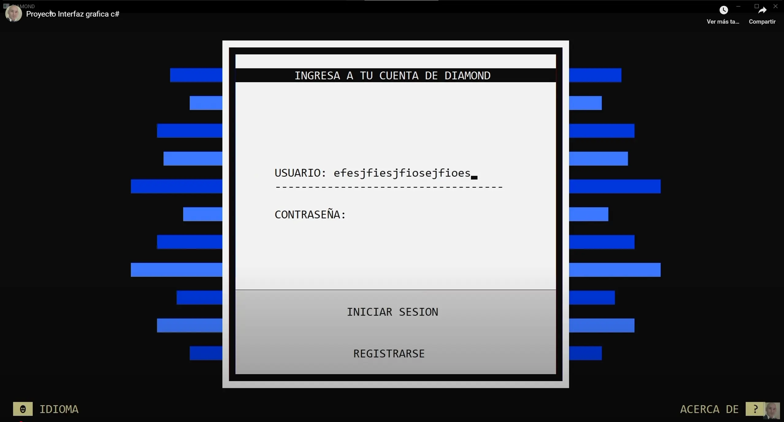</a></td>
<td><a href="https://github.com/SayGuapix/cabitemplex-launchpad">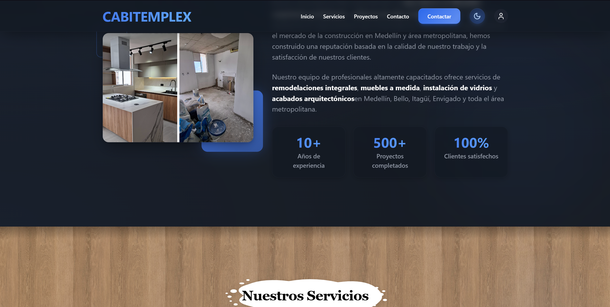</a></td>
</tr>
<tr>
<td><a href="https://santiago.vercel.app/projects">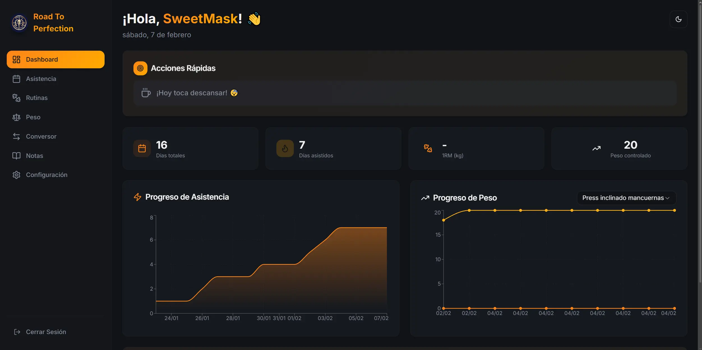</a></td>
<td colspan="2"><a href="https://github.com/SayGuapix/storebright-ops">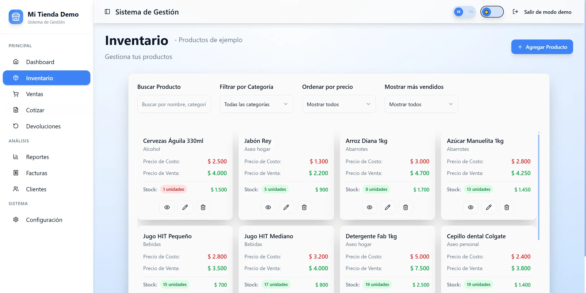</a></td>
<td><a href="https://github.com/SayGuapix/yodarby">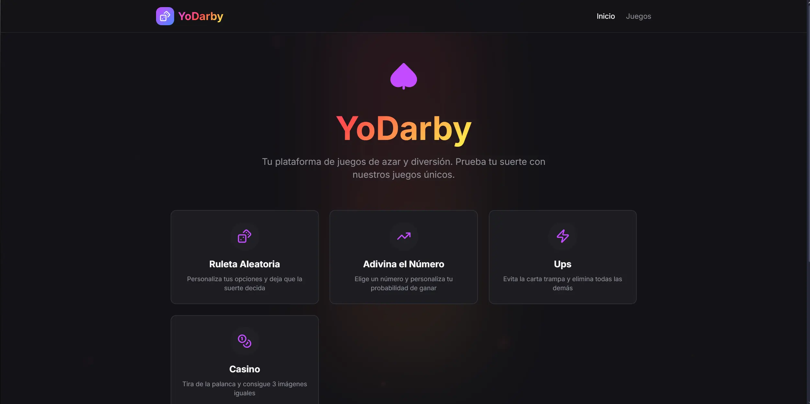</a></td>
</tr>
<tr>
<td colspan="2"><a href="https://santiago.vercel.app/projects">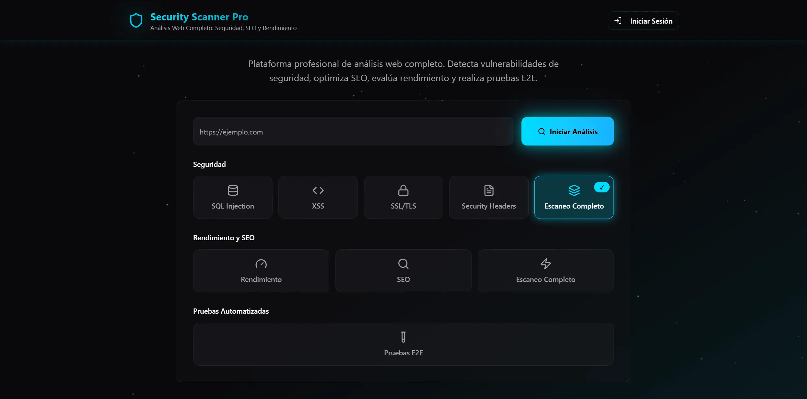</a></td>
<td><a href="https://santiago.vercel.app/projects">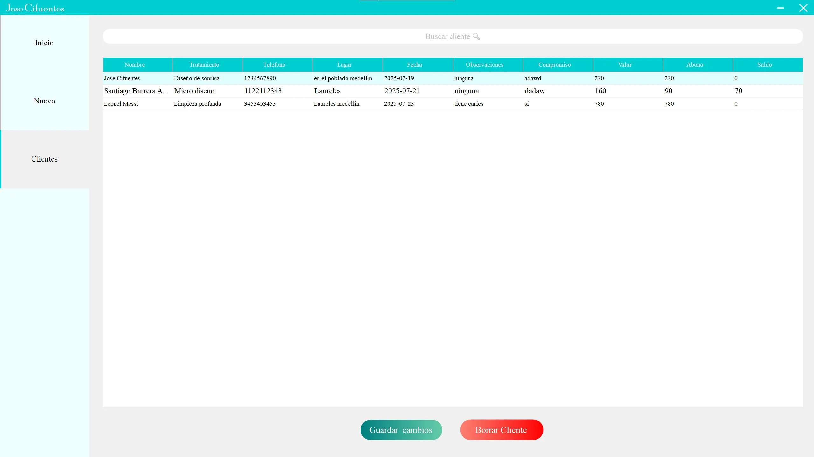</a></td>
<td><a href="https://github.com/SayGuapix/GitGlow">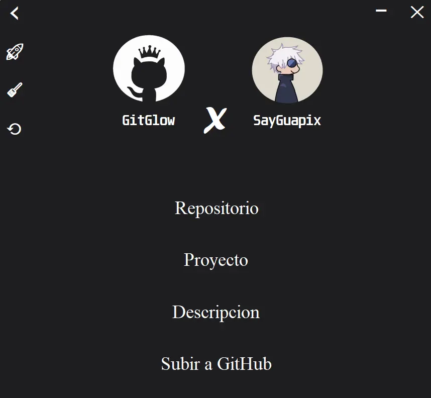</a></td>
</tr>
<tr>
<td><a href="https://github.com/SayGuapix/Amethyst">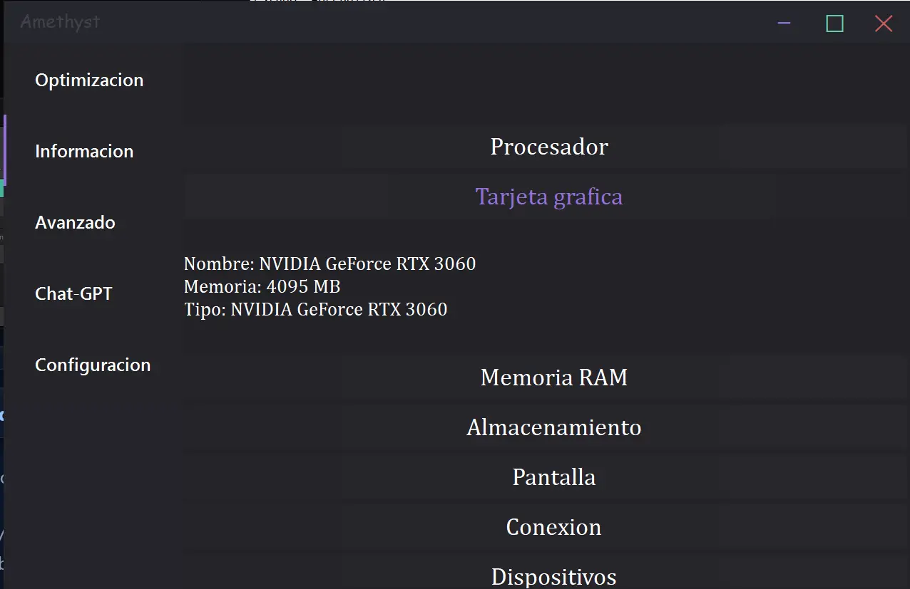</a></td>
<td colspan="2"><a href="https://github.com/SayGuapix/EmeraldCHAT">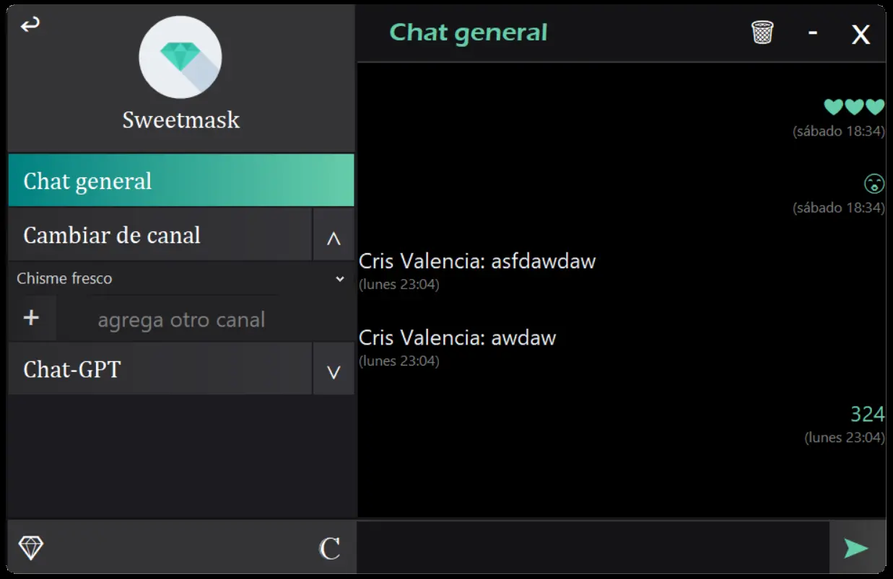</a></td>
<td><a href="https://santiago.vercel.app/projects">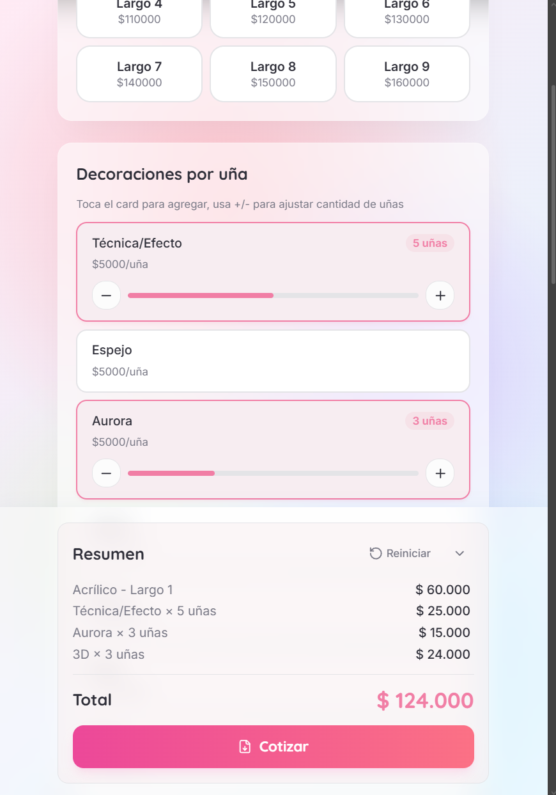</a></td>
</tr>
</table>

 

